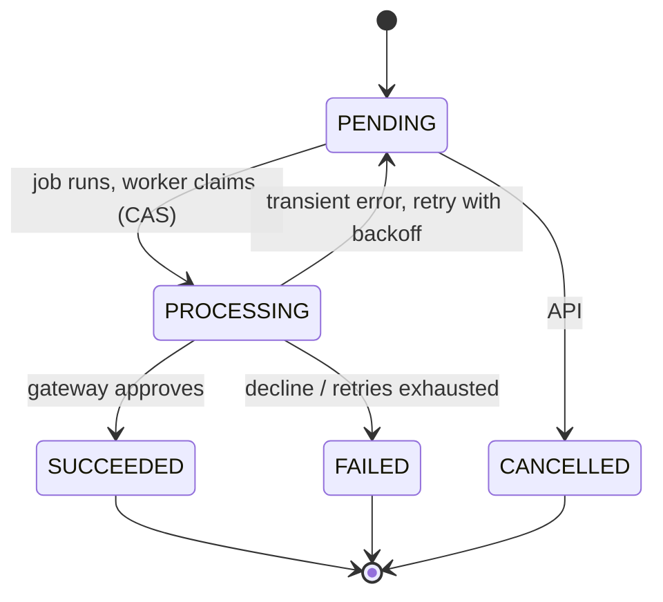
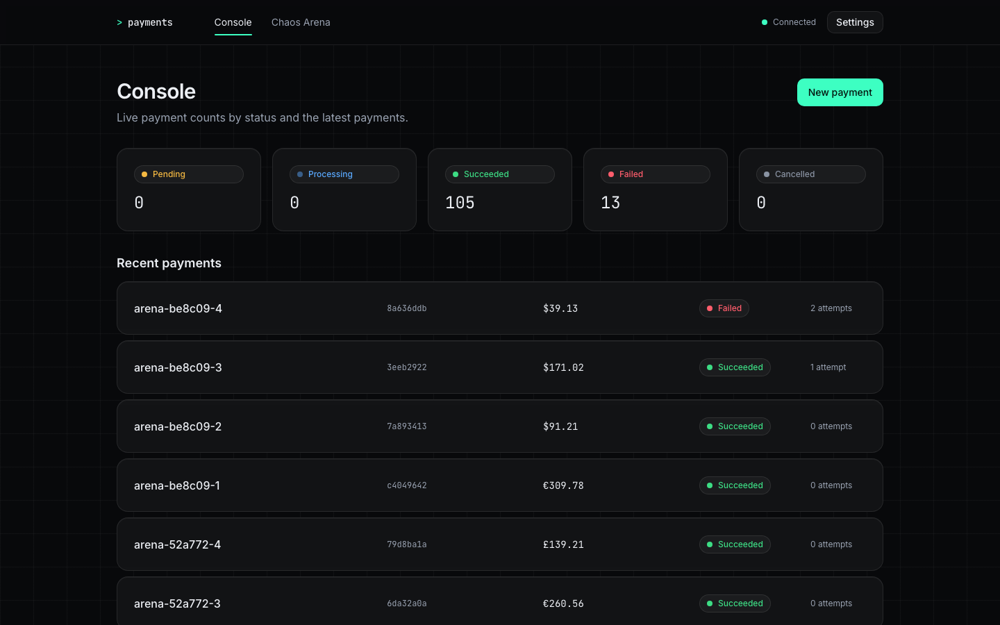
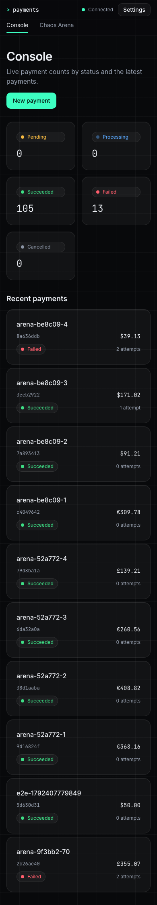
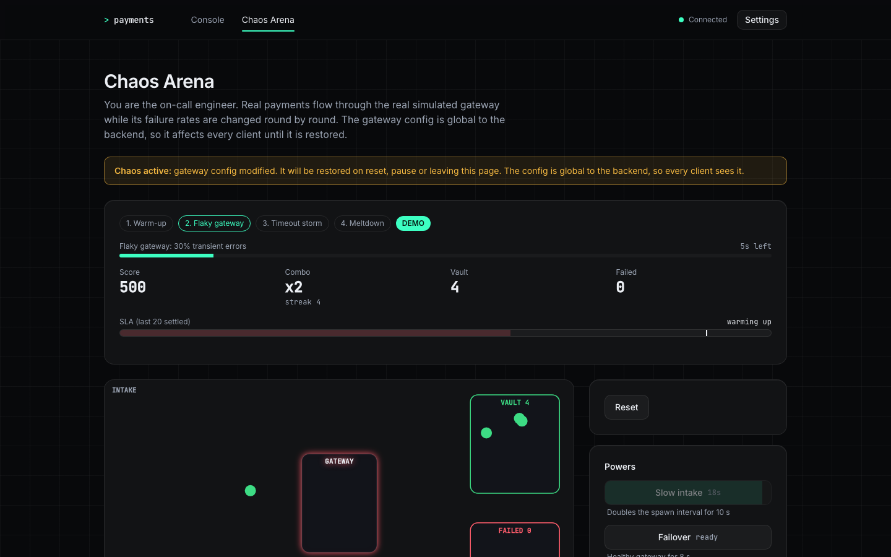
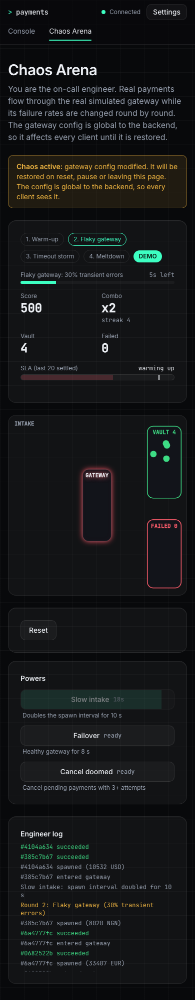

# Payment Processing Simulation

A Node.js microservice that simulates payment processing. Clients create payments through a REST API; a background worker charges them through a simulated, deliberately flaky gateway, with retries, idempotency and safe concurrent updates. A React frontend (`frontend/`) is the operator console.

Stack: Express 5, TypeScript (strict), TypeORM + SQLite (`better-sqlite3`), class-validator, pino, Jest + supertest.

## Overview

```
backend/src
  server.ts        startup, graceful shutdown, process-level handlers
  app.ts           Express assembly; middleware order lives here
  config/          validated environment variables
  database/        DataSource factory
  common/          logger, typed errors, shared middleware
  modules/<name>/  entity, dtos, repository, service, controller, routes, module
backend/test       e2e tests (supertest, in-memory SQLite)
docs/              openapi.yaml, FAILURE_MODES.md, REVIEW_LOG.md, ai-transcript/
```

AI use is documented in `docs/`: [ai-transcript/ai-transcript.md](docs/ai-transcript/ai-transcript.md) holds the prompts and response summaries, and [REVIEW_LOG.md](docs/REVIEW_LOG.md) records what the AI produced and what was changed or rejected.

Module convention: controller, service, repository. Only repositories touch TypeORM. `<name>.module.ts` wires the pieces by hand; there is no DI framework. Modules: `health`, `payments`, `gateway` (simulated provider and its chaos config), `processing` (BullMQ queue and worker, no HTTP surface).

Payment lifecycle:



## Quick start

### Local (three commands)

From the repo root, with the Node version in `.nvmrc` (22) and Docker for Redis:

```bash
npm run setup               # installs root, backend and frontend; creates backend/.env if missing
docker compose up -d redis  # Redis for the payment job queue
npm run dev                 # backend + frontend together
```

UI: http://localhost:5173. API: http://localhost:3000 (Swagger at `/docs/`). Open **Settings** in the UI and paste the `API_KEY` from `backend/.env`. The default is a public placeholder; change it. Redis can also be a local install (`brew services start redis`); the service refuses to start if `REDIS_URL` (default `redis://localhost:6379`) is unreachable.

### Docker (one command)

```bash
docker compose up --build
```

UI: http://localhost:8080 (nginx serves the app and proxies `/api` to the backend). The API is also published on http://localhost:3000, Swagger at `/docs/`. In **Settings** paste the API key, `replace-me-with-a-long-random-secret` unless you set `API_KEY` in a root `.env` (see `.env.example`).

- The backend container runs with `NODE_ENV=development` because production mode turns off schema sync and there are no migrations yet (see Known limitations). Only use the default key locally.
- Data lives in named volumes (SQLite and Redis). `docker compose down -v` resets it.
- Ports are configurable with `FRONTEND_PORT`, `BACKEND_PORT` and `REDIS_PORT`.

### Tests and CI

`npm test` at the root runs the backend and frontend suites (no Redis needed). `npm run lint` and `npm run build` run both projects too. GitHub Actions (`.github/workflows/ci.yml`) runs lint, build, tests and `npm audit --omit=dev --audit-level=high` for both on every push and pull request.

### Backend commands

Run these from `backend/`.

| Command | Purpose |
| --- | --- |
| `npm run dev` | Run with auto-reload (tsx) |
| `npm test` | Unit and e2e tests (no Redis needed) |
| `REDIS_INTEGRATION=1 npx jest payment-queue.integration` | Queue and worker against a real Redis (skipped otherwise) |
| `npm run test:cov` | Tests with coverage |
| `npm run lint` | ESLint (type-checked rules) |
| `npm run typecheck` | `tsc --noEmit` |
| `npm run build` | Compile to `dist/` |
| `npm start` | Run the compiled server |

Interactive API docs (Swagger UI, no key needed): `http://localhost:3000/docs/`. Spec: `docs/openapi.yaml`.

## Frontend

Vite + React 18 + TypeScript + Tailwind v4 + TanStack Query, in `frontend/`.

Started by `npm run dev` at the root, or on its own (`npm run dev` in `frontend/`, needs the backend on :3000).

Open **Settings** (top right) and paste the backend `API_KEY`. The default API URL `/api` goes through the Vite dev proxy to `http://localhost:3000`, so CORS is not involved. An absolute URL talks to the backend directly and needs `CORS_ORIGINS=http://localhost:5173`. Settings are kept in `sessionStorage`, so they last only for the browser tab session.

**Chaos Arena** (`/arena`) is a small game on top of the real API: you keep a payment pipeline alive while four rounds change the simulated gateway config. It creates real payments (about 24/min, under the create rate limit) and temporarily changes the global gateway config; the original config is restored on reset, pause, run end, leaving the page and page unload. Try **Auto-demo** for a ~30 s scripted run.

| Command | Purpose |
| --- | --- |
| `npm run dev` | Dev server with the `/api` proxy |
| `npm run build` | Type-check and production build to `dist/` |
| `npm run lint` | ESLint |
| `npm run typecheck` | `tsc -b --noEmit` |
| `npm test` | Vitest + Testing Library |
| `npm run test:e2e` | Playwright end-to-end tests (see below) |
| `npm run screenshots` | Regenerate `docs/media/*.png` (runs an Arena auto-demo) |

**End-to-end tests.** `npm run test:e2e` needs the backend on :3000, the Vite dev server on :5173 and `backend/.env` (the API key is read from it at run time and injected into `sessionStorage`; it is never printed). Install the browser once with `npx playwright install chromium`. The tests temporarily set a healthy gateway config and always restore the original one afterwards.

**Bundle size.** The Arena route is lazy-loaded.

| Build | Main chunk | Arena chunk |
| --- | --- | --- |
| Before (Arena in the main bundle) | 371.94 kB, 120.52 kB gzip | none |
| After | 359.10 kB, 116.09 kB gzip | 25.98 kB, 9.00 kB gzip |

The main chunk also gained the new Console create flow, so the net saving is smaller than the Arena chunk. Accessibility notes and measured contrast ratios: `docs/ACCESSIBILITY.md`.

### Screenshots

| | Desktop | Mobile |
| --- | --- | --- |
| Console |  |  |
| Chaos Arena (mid auto-demo) |  |  |

## Environment variables

Validated at startup; the service refuses to start if any is invalid (the message never prints the API key).

| Variable | Default | Constraints | Purpose |
| --- | --- | --- | --- |
| `PORT` | 3000 | int 1-65535 | HTTP port |
| `DB_PATH` | `payments.sqlite` | non-empty | SQLite file (`:memory:` for throwaway runs) |
| `API_KEY` | none (required) | string, min 16 chars; in production must not be the `.env.example` placeholder | Shared secret for the `X-API-Key` header |
| `CORS_ORIGINS` | `http://localhost:5173` | comma-separated origins, no paths | Browser origins allowed to call the API |
| `NODE_ENV` | `development` | `development`, `test`, `production` | Production turns off schema `synchronize` |
| `RATE_LIMIT_WINDOW_MS` | 60000 | int 1000-3600000 | Rate-limit window |
| `RATE_LIMIT_MAX` | 300 | int 1-100000 | Requests per client IP per window, all routes |
| `RATE_LIMIT_CREATE_MAX` | 30 | int 1-100000 | Extra, stricter limit for `POST /payments` |
| `GATEWAY_MIN_LATENCY_MS` | 100 | int 0-10000, <= max | Simulated gateway latency, lower bound |
| `GATEWAY_MAX_LATENCY_MS` | 800 | int 0-10000 | Simulated gateway latency, upper bound |
| `GATEWAY_FAILURE_RATE` | 0.2 | 0-1 | Chance of a transient error |
| `GATEWAY_DECLINE_RATE` | 0.1 | 0-1 | Chance of a final decline |
| `GATEWAY_TIMEOUT_RATE` | 0.05 | 0-1; the three rates sum to <= 1 | Chance the call hangs until aborted |
| `GATEWAY_TIMEOUT_MS` | 5000 | int 100-60000 | How long the worker waits for one gateway call |
| `REDIS_URL` | `redis://localhost:6379` | `redis://` or `rediss://` URL (never echoed in errors) | Redis for the BullMQ payment queue |
| `PROCESSOR_CONCURRENCY` | 10 | int 1-100 | Payments charged in parallel by this process |
| `PROCESSOR_MAX_ATTEMPTS` | 5 | int 1-20 | Attempts before a payment fails |

## API

Every route except `GET /health` and `/docs` needs `X-API-Key`. Unknown routes also return 401 without a key, so paths are not revealed. Amounts are integers in minor units (5000 NGN = 50.00); currencies are `NGN`, `USD`, `EUR`, `GBP`. All errors share one shape: `{ statusCode, error, message, details, path, requestId, timestamp }`.

| Method and path | Success | Errors |
| --- | --- | --- |
| `GET /health` | 200 (`redis` is `up` or `down`) | 503 database down |
| `POST /payments` | 202 + `Location`; 200 + `Idempotent-Replayed: true` on replay | 400, 409 key reused with another body, 413, 429 |
| `GET /payments?status=&page=&limit=` | 200 `{ data, page, limit, total }`, newest first, limit max 100 | 400 |
| `GET /payments/stats` | 200 count per status plus `total` | |
| `GET /payments/{id}` | 200 | 400 not a UUID, 404 |
| `PATCH /payments/{id}/status` | 200 | 400, 404, 409 illegal transition |
| `GET /gateway/config` | 200 | |
| `PUT /gateway/config` | 200 (full replace) | 400 |

All routes can also return 401 and 429.

```bash
export K='X-API-Key: your-secret'
B=http://localhost:3000

curl $B/health

curl -X POST $B/payments -H "$K" -H 'Content-Type: application/json' \
  -H 'Idempotency-Key: order-1001' \
  -d '{"amount":5000,"currency":"NGN","customerEmail":"a@example.com"}'
# repeat the same command: 200 with Idempotent-Replayed: true and the same payment

curl -H "$K" "$B/payments?status=PENDING&page=1&limit=20"
curl -H "$K" $B/payments/stats
curl -H "$K" $B/payments/<id>

curl -X PATCH $B/payments/<id>/status -H "$K" -H 'Content-Type: application/json' \
  -d '{"status":"CANCELLED","reason":"customer changed mind"}'

curl -H "$K" $B/gateway/config
curl -X PUT $B/gateway/config -H "$K" -H 'Content-Type: application/json' \
  -d '{"minLatencyMs":0,"maxLatencyMs":10,"failureRate":0,"declineRate":1,"timeoutRate":0}'   # decline everything
```

## Design decisions and trade-offs

- **Layering without DI.** Controller, service, repository, wired by hand in each `*.module.ts`. Less indirection for a service this size; tests inject fakes through constructors.
- **Integer minor units.** No floats for money; the DTO rejects floats and numeric strings.
- **Compare-and-set with a version.** Status changes are `UPDATE ... WHERE id AND status AND version`, bumping `version`. Checking status alone is open to ABA: PENDING to PROCESSING to PENDING between a read and a write looks unchanged. A lost CAS returns 409 against the fresh state instead of overwriting.
- **Idempotency.** Optional `Idempotency-Key` with a unique index. The lookup handles the common replay; the unique index decides a concurrent race, and the loser re-reads and replays the winner. Same key with a different body is 409.
- **BullMQ on Redis for background work.** Creating a payment (and a PATCH back to PENDING) enqueues a `charge` job with `jobId = paymentId`, so a payment never has two jobs. BullMQ owns concurrency (`PROCESSOR_CONCURRENCY`), retries, delays and crash recovery: a worker that dies mid-job loses its lock and BullMQ re-runs the job (the handler reclaims the abandoned PROCESSING row). Claiming is still a CAS on the row, so a cancel or PATCH can never be overwritten. Several instances can process safely.
- **The database is the source of truth, the queue is a trigger.** If Redis is down when a payment is created, the request still succeeds, the error is logged and the row stays PENDING. On every boot the service re-enqueues all PENDING and PROCESSING rows (deduplicated by jobId), which also recovers from a Redis that lost its data. Boot fails fast, with a clear log line, if Redis is unreachable.
- **Full-jitter backoff via a custom BullMQ backoff.** The handler picks a random delay up to `min(30s, 1s * 2^attempts)`, stores it as `nextAttemptAt` and throws it; BullMQ's backoff strategy returns that same delay, so the database and the queue agree. A decline is final and is not retried.
- **Timeout via abort and race.** The gateway call gets an `AbortSignal` and is also raced against a timer, so a gateway that ignores the signal cannot hold a worker slot forever.
- **Gateway caches only final outcomes.** Approvals and declines are remembered per payment (no double charge); transient errors and timeouts are not, or retries would replay the failure.
- **One error shape.** Typed `AppError` subclasses, one global handler; 429 and body-parser errors go through it too. No stack traces or driver text reach clients.
- **Rate limit before auth.** Failed key guesses count against the limit. `POST /payments` has an additional stricter limit.
- **Timing-safe key comparison.** Both keys are SHA-256 hashed and compared with `timingSafeEqual`, so key length is not leaked by an early length check.
- **Security headers and CORS.** helmet defaults (its CSP works with Swagger UI unchanged: scripts are same-origin files, styles are allowed inline), 10kb body limit, CORS allow-list that omits the header instead of erroring for unknown origins. Logs redact the API key header and `customerEmail`.

## Known limitations

- SQLite, one file: the database does not support several instances in practice (the file is local). Processing itself no longer assumes one instance.
- The worker runs inside the API process (a separate worker process would need only `processing.module.ts`).
- Redis is a hard dependency at boot. If it dies while running, API calls still work and new payments stay PENDING until the next restart reconciles them; jobs already in Redis are lost only if Redis loses its data (enable AOF persistence in production), and then the boot reconcile re-creates them.
- A PATCH back to PENDING during the job's very last attempt is not retried until the next boot reconcile.
- BullMQ's stalled-job check runs every 30 s, so a payment whose worker crashed can wait up to about a minute before it is re-run.
- Gateway idempotency state and rate-limit counters are in memory: lost on restart, per process. Behind a reverse proxy, `trust proxy` must be configured or all clients share one rate-limit bucket.
- Schema comes from TypeORM `synchronize`, which is off in production, so a fresh production database has no tables. Production mode is not runnable as-is.
- A single shared API key, no per-client identity or revocation.
- `PATCH` on a PROCESSING payment wins over the worker's result, but the gateway may already have charged; nothing reconciles that.
- Everything untested is listed in `docs/FAILURE_MODES.md`.

## What I would change for production

- Postgres, so several API instances can share one database.
- Real migrations instead of `synchronize`.
- A separate worker process and Redis with persistence (AOF) or a managed queue.
- Per-client API keys, stored hashed, with rotation.
- A distributed rate-limit store (the Redis we now run could serve it).
- Outbox pattern and webhooks to notify clients of final status.
- Metrics and tracing (queue depth, attempt counts, gateway latency).
- Send idempotency keys to the real payment provider so a retry after a crash cannot double charge.
