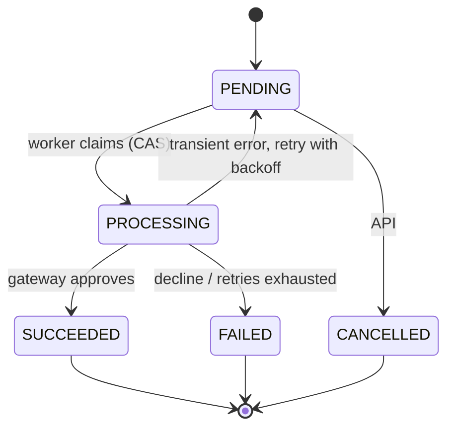

# Payment Processing Simulation

A Node.js microservice that simulates payment processing. Clients create payments through a REST API; a background worker charges them through a simulated, deliberately flaky gateway, with retries, idempotency and safe concurrent updates. A React frontend is planned.

Stack: Express 5, TypeScript (strict), TypeORM + SQLite (`better-sqlite3`), class-validator, pino, Jest + supertest.

## Overview

```
backend/src
  server.ts        startup, graceful shutdown, process-level handlers
  app.ts           Express assembly; middleware order lives here
  config/          validated environment variables
  database/        DataSource factory
  common/          logger, typed errors, shared middleware
  modules/<name>/  entity, dtos, repository, service, controller, routes, module
backend/test       e2e tests (supertest, in-memory SQLite)
docs/              openapi.yaml, FAILURE_MODES.md
```

Module convention: controller, service, repository. Only repositories touch TypeORM. `<name>.module.ts` wires the pieces by hand; there is no DI framework. Modules: `health`, `payments`, `gateway` (simulated provider and its chaos config), `processing` (background worker, no HTTP surface).

Payment lifecycle:



## Quick start

Prerequisite: Node.js >= 20.

```bash
cd backend
npm install
cp .env.example .env     # then set API_KEY to your own secret (min 16 chars)
npm run dev
```

| Command | Purpose |
| --- | --- |
| `npm run dev` | Run with auto-reload (tsx) |
| `npm test` | Unit and e2e tests |
| `npm run test:cov` | Tests with coverage |
| `npm run lint` | ESLint (type-checked rules) |
| `npm run typecheck` | `tsc --noEmit` |
| `npm run build` | Compile to `dist/` |
| `npm start` | Run the compiled server |

Interactive API docs (Swagger UI, no key needed): `http://localhost:3000/docs/`. Spec: `docs/openapi.yaml`.

## Environment variables

Validated at startup; the service refuses to start if any is invalid (the message never prints the API key).

| Variable | Default | Constraints | Purpose |
| --- | --- | --- | --- |
| `PORT` | 3000 | int 1-65535 | HTTP port |
| `DB_PATH` | `payments.sqlite` | non-empty | SQLite file (`:memory:` for throwaway runs) |
| `API_KEY` | none (required) | string, min 16 chars; in production must not be the `.env.example` placeholder | Shared secret for the `X-API-Key` header |
| `CORS_ORIGINS` | `http://localhost:5173` | comma-separated origins, no paths | Browser origins allowed to call the API |
| `NODE_ENV` | `development` | `development`, `test`, `production` | Production turns off schema `synchronize` |
| `RATE_LIMIT_WINDOW_MS` | 60000 | int 1000-3600000 | Rate-limit window |
| `RATE_LIMIT_MAX` | 300 | int 1-100000 | Requests per client IP per window, all routes |
| `RATE_LIMIT_CREATE_MAX` | 30 | int 1-100000 | Extra, stricter limit for `POST /payments` |
| `GATEWAY_MIN_LATENCY_MS` | 100 | int 0-10000, <= max | Simulated gateway latency, lower bound |
| `GATEWAY_MAX_LATENCY_MS` | 800 | int 0-10000 | Simulated gateway latency, upper bound |
| `GATEWAY_FAILURE_RATE` | 0.2 | 0-1 | Chance of a transient error |
| `GATEWAY_DECLINE_RATE` | 0.1 | 0-1 | Chance of a final decline |
| `GATEWAY_TIMEOUT_RATE` | 0.05 | 0-1; the three rates sum to <= 1 | Chance the call hangs until aborted |
| `GATEWAY_TIMEOUT_MS` | 5000 | int 100-60000 | How long the worker waits for one gateway call |
| `PROCESSOR_POLL_INTERVAL_MS` | 1000 | int 100-60000 | Time between worker ticks |
| `PROCESSOR_BATCH_SIZE` | 10 | int 1-100 | Payments per tick |
| `PROCESSOR_MAX_ATTEMPTS` | 5 | int 1-20 | Attempts before a payment fails |

## API

Every route except `GET /health` and `/docs` needs `X-API-Key`. Unknown routes also return 401 without a key, so paths are not revealed. Amounts are integers in minor units (5000 NGN = 50.00); currencies are `NGN`, `USD`, `EUR`, `GBP`. All errors share one shape: `{ statusCode, error, message, details, path, requestId, timestamp }`.

| Method and path | Success | Errors |
| --- | --- | --- |
| `GET /health` | 200 | 503 database down |
| `POST /payments` | 202 + `Location`; 200 + `Idempotent-Replayed: true` on replay | 400, 409 key reused with another body, 413, 429 |
| `GET /payments?status=&page=&limit=` | 200 `{ data, page, limit, total }`, newest first, limit max 100 | 400 |
| `GET /payments/stats` | 200 count per status plus `total` | |
| `GET /payments/{id}` | 200 | 400 not a UUID, 404 |
| `PATCH /payments/{id}/status` | 200 | 400, 404, 409 illegal transition |
| `GET /gateway/config` | 200 | |
| `PUT /gateway/config` | 200 (full replace) | 400 |

All routes can also return 401 and 429.

```bash
export K='X-API-Key: your-secret'
B=http://localhost:3000

curl $B/health

curl -X POST $B/payments -H "$K" -H 'Content-Type: application/json' \
  -H 'Idempotency-Key: order-1001' \
  -d '{"reference":"order-1001","amount":5000,"currency":"NGN","customerEmail":"a@example.com"}'
# repeat the same command: 200 with Idempotent-Replayed: true and the same payment

curl -H "$K" "$B/payments?status=PENDING&page=1&limit=20"
curl -H "$K" $B/payments/stats
curl -H "$K" $B/payments/<id>

curl -X PATCH $B/payments/<id>/status -H "$K" -H 'Content-Type: application/json' \
  -d '{"status":"CANCELLED","reason":"customer changed mind"}'

curl -H "$K" $B/gateway/config
curl -X PUT $B/gateway/config -H "$K" -H 'Content-Type: application/json' \
  -d '{"minLatencyMs":0,"maxLatencyMs":10,"failureRate":0,"declineRate":1,"timeoutRate":0}'   # decline everything
```

## Design decisions and trade-offs

- **Layering without DI.** Controller, service, repository, wired by hand in each `*.module.ts`. Less indirection for a service this size; tests inject fakes through constructors.
- **Integer minor units.** No floats for money; the DTO rejects floats and numeric strings.
- **Compare-and-set with a version.** Status changes are `UPDATE ... WHERE id AND status AND version`, bumping `version`. Checking status alone is open to ABA: PENDING to PROCESSING to PENDING between a read and a write looks unchanged. A lost CAS returns 409 against the fresh state instead of overwriting.
- **Idempotency.** Optional `Idempotency-Key` with a unique index. The lookup handles the common replay; the unique index decides a concurrent race, and the loser re-reads and replays the winner. Same key with a different body is 409.
- **Self-scheduling worker.** Each tick schedules the next only after it finishes, so ticks never overlap. Claiming a payment is a CAS PENDING to PROCESSING, so two workers cannot take the same row.
- **Full-jitter backoff.** Random delay up to `min(30s, 1s * 2^attempts)` avoids synchronised retry bursts.
- **Timeout via abort and race.** The gateway call gets an `AbortSignal` and is also raced against a timer, so a gateway that ignores the signal cannot hang the batch.
- **Gateway caches only final outcomes.** Approvals and declines are remembered per payment (no double charge); transient errors and timeouts are not, or retries would replay the failure.
- **One error shape.** Typed `AppError` subclasses, one global handler; 429 and body-parser errors go through it too. No stack traces or driver text reach clients.
- **Rate limit before auth.** Failed key guesses count against the limit. `POST /payments` has an additional stricter limit.
- **Timing-safe key comparison.** Both keys are SHA-256 hashed and compared with `timingSafeEqual`, so key length is not leaked by an early length check.
- **Security headers and CORS.** helmet defaults (its CSP works with Swagger UI unchanged: scripts are same-origin files, styles are allowed inline), 10kb body limit, CORS allow-list that omits the header instead of erroring for unknown origins. Logs redact the API key header and `customerEmail`.

## Known limitations

- SQLite, one file, one instance.
- The worker runs inside the API process. Startup recovery assumes every PROCESSING row is abandoned, so a second instance would steal live work.
- Gateway idempotency state and rate-limit counters are in memory: lost on restart, per process. Behind a reverse proxy, `trust proxy` must be configured or all clients share one rate-limit bucket.
- Schema comes from TypeORM `synchronize`, which is off in production, so a fresh production database has no tables. Production mode is not runnable as-is.
- A single shared API key, no per-client identity or revocation.
- `PATCH` on a PROCESSING payment wins over the worker's result, but the gateway may already have charged; nothing reconciles that.
- Everything untested is listed in `docs/FAILURE_MODES.md`.

## What I would change for production

- Postgres, with `SELECT ... FOR UPDATE SKIP LOCKED` or a lease column so several workers can run safely.
- Real migrations instead of `synchronize`.
- A real queue (BullMQ, SQS) and a separate worker process.
- Per-client API keys, stored hashed, with rotation.
- A distributed rate-limit store (Redis).
- Outbox pattern and webhooks to notify clients of final status.
- Metrics and tracing (queue depth, attempt counts, gateway latency).
- Send idempotency keys to the real payment provider so a retry after a crash cannot double charge.
